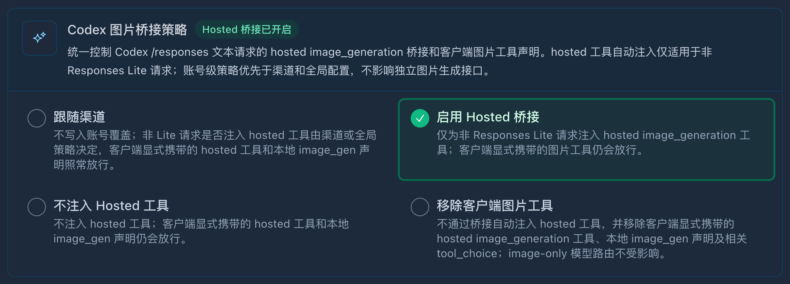

# codex-sub2api-image-gen


一个给 Codex 使用的图片生成 Skill。你可以直接说「用 GPT Image」来走配置好的 Images API。普通生图请求也可在内置工具不可用时使用这条路径。

## 特点

- 自动读取所选 provider 的 `base_url`、`experimental_bearer_token` 和自定义请求头，支持单独绑定图片 provider。
- 使用非 OpenAI SDK 的 User-Agent，绕开已知的 sub2api / Cloudflare SDK 请求头拦截。
- 支持图片生成、图片编辑、无费用连通性检查和脱敏 dry run。
- 仅依赖 Python 标准库，不安装 OpenAI SDK。
- 默认使用 `gpt-image-2.6-sunburst`，尺寸为 `auto`；服务端返回多大就原样保存多大，不在本地超分、缩放、补边或重采样。

## 环境要求

- Codex
- Python 3.11+，或 uv（自动准备兼容的 Python）
- 已配置且支持 Images API 的 Codex custom provider / sub2api

## 安装

把整个仓库直接克隆到 Skill 目录：

```bash
mkdir -p ~/.agents/skills
git clone https://github.com/huysh3/sub2api-gpt-image-2.git ~/.agents/skills/sub2api-imagegen
```

仓库根目录就是 Skill 根目录，不需要绑定或创建专属 Agent。重启 Codex 或开启一个新任务即可使用。

## 使用

直接说「GPT Image」或「GPT Image 2.6」，加上要生成或编辑的内容即可。Codex 会自动选型号并传入完整 ID。

```text
用 GPT Image 生成一张雨夜霓虹街道的横版图片
```

```text
用 GPT Image 2.6 把 input.png 的整体色温调暖一点，其余保持原样
```

| 提示词意图 | Codex 传入的模型 |
| --- | --- |
| 明确指定 Flare / Sunburst 或完整模型名 | 严格使用指定型号，优先于下面的自动选择 |
| 只对已有图片做明确的小幅微调，例如略微提亮或调暖 | `gpt-image-2.6-flare` |
| 新图、较大改动、需要保留精确细节，或难度不明确 | `gpt-image-2.6-sunburst`（默认） |

普通请求会直接选型，即使是草稿也优先 Sunburst。只有在凭现有信息无法判断、且选错会明显影响结果时，才请用户选一次。例如精细编辑需要 Sunburst，但上游只提供 Flare。

也可以在 Codex 中用 `$sub2api-imagegen` 显式调用。直接运行 Python 客户端时，可用 `--model` 覆盖默认值。排查 provider 连通性可运行：

```bash
python3 ~/.agents/skills/sub2api-imagegen/scripts/sub2api_image_gen.py doctor
```

没有 Python 3.11+ 时，可直接使用 uv；脚本已声明 Python 版本，uv 会自动准备解释器（首次可能需要下载），无需安装 SDK：

```bash
uv run ~/.agents/skills/sub2api-imagegen/scripts/sub2api_image_gen.py doctor
uv run ~/.agents/skills/sub2api-imagegen/scripts/sub2api_image_gen.py generate --model gpt-image-2.6-sunburst --prompt "雨夜霓虹街道" --out output/imagegen/street.png
```

`generate`、`edit`、`doctor` 均通过 `--model` 选择完整模型名，无需额外分型参数：

| 模型 | 适用场景 |
| --- | --- |
| `gpt-image-2.6-sunburst`（本客户端默认） | 新图、较大改动和精细编辑 |
| `gpt-image-2.6-flare` | 小幅微调，或用户点名时用于生成和编辑 |

仍可用完整 ID 指定 `gpt-image-2.5-sunburst`、`gpt-image-2.5-flare` 或其 `-2026-09-08` 快照。版本号本身不是路由规则，`--model` 传给上游时保留原值。`gpt-image-2.5` 和 `gpt-image-2.6` 不是官方型号 ID。

`--quality` 支持 `low/medium/high/xhigh/max/auto`，客户端默认 `medium`。2.5 和 2.6 的默认尺寸为 `auto`。显式尺寸须为 16 的倍数，最长边 ≤3840，宽高比在 1:3～3:1，总像素 655,360～8,294,400。2.5 高于 2560×1440 属实验范围。透明背景使用 PNG 或 WebP。

2.6 支持 `--complexity low|medium|high` 调整生成和编辑的规划程度。省略时由 API 使用 `high`。生成与编辑都可用 `--output-format gif` 输出动画，并可指定 `--frame-count 2–16` 和 `--frame-duration-ms 20–2000`。GIF 用 `auto` 尺寸可让上游按像素预算选取帧尺寸。用 `generate --output-format svg` 可生成单张 SVG。指定 `--out` 时，省略扩展名可让客户端自动补上格式后缀。

```bash
uv run ~/.agents/skills/sub2api-imagegen/scripts/sub2api_image_gen.py generate --model gpt-image-2.6-flare --prompt "剪纸翠鸟拍动翅膀，循环回到起始姿势" --output-format gif --frame-count 9 --frame-duration-ms 200 --out output/imagegen/kingfisher.gif
```

参见 [OpenAI GPT Image 2.6 指南](https://developers.openai.com/api/docs/guides/image-generation#gpt-image-26)。

## 路由与凭证

如果 Codex 默认使用 Magpie 等对话入口，可以在每台电脑上给 Skill 单独指定图片 provider。保留 `config.toml` 顶层的 `model_provider`，在同目录新建 `sub2api-imagegen.toml`（通常是 `~/.codex/sub2api-imagegen.toml`）：

```toml
provider = "my-image-provider"
```

把 `my-image-provider` 换成该电脑 `config.toml` 中已有的 `[model_providers.<ID>]` 的 ID。若尚无图片 provider，先添加支持 Images API 的 provider 条目及对应凭证。绑定文件只写 ID。之后直接运行 `doctor`，应显示图片 provider 和模型是否可用；`generate` 和 `edit` 也会自动使用同一绑定。

- 配置路径：`--config PATH` > `$CODEX_HOME/config.toml` > `~/.codex/config.toml`。
- provider：`--provider ID` > 所选配置文件同目录的 `sub2api-imagegen.toml` > `config.toml` 顶层 `model_provider`。绑定无效时会报错，不回退到默认 provider。
- endpoint：`OPENAI_BASE_URL` > 所选 provider 的 `base_url`；必须显式配置，不自动切换到 OpenAI 官方地址。
- API key：`OPENAI_API_KEY` 环境变量 > provider 的 `experimental_bearer_token` > 配置文件同目录 `auth.json` 的顶层 `OPENAI_API_KEY`。
- 如果终端里的 `OPENAI_BASE_URL` 或 `OPENAI_API_KEY` 是给 Magpie 设置的，只在图片命令的进程里取消相应变量，否则它们仍会覆盖图片 provider 的值。
- 仅当前两项缺失时读取 `auth.json`；不读取 OAuth `tokens`。该 API key 会用于上述 endpoint，请确保二者匹配。使用 `--config` 时不会再读取默认目录的认证文件。
- 仅有 `auth.json` 时，可设置 `OPENAI_BASE_URL`，无需创建 `config.toml`。dry run 会标明是否使用了认证文件，但不输出 key。

当前已在 Codex 图片策略选择「启用 Hosted 桥接」的配置下测试通过：



## 分辨率说明

尺寸默认 `auto`，也可用 `--size 1536x864` 等合法尺寸显式指定。请求尺寸不等于输出承诺；客户端检测实际 PNG 尺寸，遇到差异会提示，并原样保存服务端字节，不进行本地放大、缩放或补边。

## 安全说明

- 凭证只从本机环境变量、Codex 配置或 `auth.json` 读取，不写入仓库或生成文件。
- 客户端不主动打印 bearer token 或完整请求头；dry run 也不包含凭证。
- `doctor` 和 dry run 会显示当前 provider 的 base URL，API 错误会包含上游返回的错误正文。公开日志前请检查其中是否包含私人域名、路径或上游回显的信息。
- 不要提交 `.env`、`config.toml`、API key、cookie 或真实请求日志；仓库自带的 `.gitignore` 会忽略常见本地凭证文件。

## 已知限制

- `doctor` 只能验证路由连通和模型列表，不能保证付费生成一定成功。
- 不自动重试付费请求。
- Sunburst 和 Flare 均支持透明背景；使用 `--background transparent --output-format png`（或 `webp`）。
- 实际支持的模型、尺寸和质量参数取决于上游兼容实现。

## License

本项目采用 [MIT License](LICENSE)。

## 本地验证

```bash
uv run --python 3.11 tests/test_sub2api_image_gen.py
```

测试使用本地 HTTP 服务和虚拟凭证，不调用付费接口。
